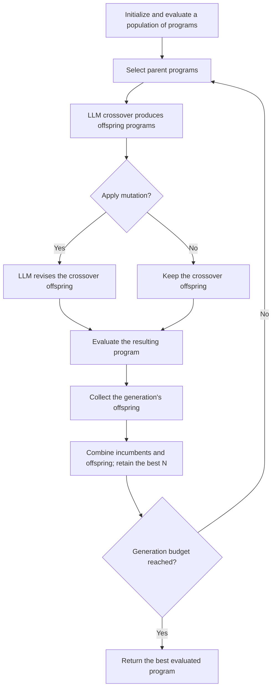

# AEL: paper method and our Circle Packing continuation

Date: 2026-10-31. Main paper: Fei Liu, Xialiang Tong, Mingxuan Yuan and Qingfu Zhang, *Algorithm Evolution Using Large Language Model*, [arXiv:2311.15249v1](https://arxiv.org/abs/2311.15249).

**Reading stage completed; the AEL offspring experiment has not started.** This review covers the supplied paper's main text (PDF pp.1-9), including its method, prompt figure, reported settings, results and limitations. PDF pp.10-11 contain references. The source PDF identity and the inspected local preparation files are recorded in `AEL_READINESS_AUDIT.json`.

**Subsequent parent check:** The separate [2026-10-31 diagnostic](../../../ael_parent_eligibility_20261031/AEL_PARENT_ELIGIBILITY_RESULTS.md) has now completed the thirty-program runtime check: 22 valid positive-score options and 8 timeouts. This review's zero-evaluation count describes the earlier reading/preparation phase; the diagnostic has its own registration and thirty outcome records.

## 1. What AEL evolves

An AEL individual is an **algorithm program**, with a short natural-language description, executable source and an evaluator-derived fitness. A TSP route or a returned packing is the output of that program. It is not the evolutionary individual.

For our task, an individual contains a `pack_circles(n)` program. Executing it at n=26 produces circle coordinates and radii; the fixed evaluator checks geometry and computes the sum of radii. The local LLM generates or revises programs. It does not assign their fitness.

This preserves the core AEL idea while applying the already chosen Circle Packing adaptation. We are not switching the project back to TSP.

## 2. The actual AEL loop

Source: Section III.A-G, Algorithm 1 and Fig.2 (PDF pp.3-5).

The framework allows initialization from existing algorithms or LLM-generated algorithms (Section **III.C**, PDF p.4). Its reported experiment chooses LLM-generated initialization. Historical initialization is therefore a departure from the reported experiment, not a violation of the general framework.

Parent selection is equal-probability random selection in the paper experiment (Section III.D). Crossover receives several parent descriptions and source programs. Mutation revises **one newly created offspring**. After N offspring groups are collected, the population is reduced from `(s+1)N` to N by fitness.

Calling crossover on two historical programs is an AEL-inspired operator test. Independently mutating a historical program is also an operator test. Neither, by itself, is the full population-based AEL procedure. The full loop must track which crossover output was supplied to mutation.

## 3. Three prompt types, with different purposes

Source: Sections III.C, III.E-F and IV.A.2; Fig.4 (PDF pp.4-6).

| Prompt | Program context | Requested behavior |
|---|---|---|
| Initialization | No parent program | Propose an initial algorithm with the required interface. |
| Crossover | Two parents in the reported experiment; descriptions and source | Produce one distinct algorithm motivated by the parents. |
| Mutation | One crossover offspring in the complete loop | Revise that algorithm, retaining a valid interface. |

The paper builds prompts from the task, parent descriptions/source where appropriate, operator-specific hints, expected output and other hints. The TSP examples request a short description delimited by `<start>` and `<end>` and code implementing `select_next_node(...)`.

Our existing Circle Packing drafts instead require one code block, one top-level `pack_circles(n: int) -> np.ndarray` function, approved imports, and a short method description inside the docstring. Those formatting and task restrictions are adaptations. They must be held constant when comparing prompts.

The crossover and mutation drafts prepared in the previous step are reused by source path and hash in `AEL_PROMPT_PACK.json`. Only the missing initialization draft is added in this continuation. It is an alternative initial-population route; the historical-seeding decision is preserved.

## 4. What the paper actually tested

Source: Section IV.A-B, PDF pp.5-8.

| Setting | Reported value |
|---|---|
| Evolved task | Constructive next-node selection for TSP |
| Fitness cases | 64 randomly generated TSP50 instances |
| Fitness | Average gap to a Gurobi solution; lower is better |
| Population size | 10 |
| Generations | 10 |
| Crossover probability | 1.0 |
| Mutation probability | 0.2 |
| Parents per crossover | 2 |
| Offspring per crossover | 1 |
| LLMs | GPT-3.5-turbo and GPT-4 |

The paper compares greedy construction, a POMO domain model, direct LLM generation and AEL, then evaluates the produced algorithms on TSP20, 50, 100, 200, 500 and 1000. Table I uses **LKH3** as its comparison baseline; this differs from the Gurobi-based evolution fitness described above.

For example, Table I reports greedy versus AEL/GPT-4 gaps of 23.1% versus 11.1% at TSP50, and 25.2% versus 12.8% at TSP1000. POMO is stronger near the TSP50 training size but deteriorates in the paper's larger-size tests. These are the paper's results, not our measurements or a guarantee for Circle Packing/Qwen.

The reported direct-LLM baseline summarizes ten generated algorithms. It should not be described as an equal-call-budget causal comparison with the entire evolutionary procedure. The paper mentions 100 LLM interactions in its result discussion, while its pseudocode also includes initialization and probabilistic mutation. Our implementation must record actual calls rather than infer a complete request budget from that sentence.

## 5. Connection to our supervisor's research question

| Component | AEL paper | Our recorded direction |
|---|---|---|
| Program being evolved | TSP next-node heuristic | Full Circle Packing program, n=26 |
| Score direction | Minimize TSP gap | Maximize feasible sum of radii |
| Initial programs | LLM-created in the experiment | Historical archive, with explicit source identities |
| Parent selection | Equal probability | Compare a declared baseline with an NBN-guided choice; this is an extension |
| LLM | GPT-3.5-turbo / GPT-4 | Local/open-source model, with exact package/settings recorded |
| Landscape guidance | No NBN method is specified | Frozen NBN code-space structure and representative historical programs |
| Success of interest | Better TSP construction | Quality, target >=2.6360, validity and structural diversity |

Section V explicitly discusses additional information such as external archives and search history as future directions. That motivates investigating our archive/NBN information; it does not establish that NBN guidance works. NBN-based parent choice is our hypothesis to test.

A different code hash is insufficient to demonstrate a new algorithmic mechanism. A new branch in a display is also insufficient without a defined representation, graph identity, scores and actual computed placement. AEL's paper results do not establish our local-model quality, historical-score comparability or official challenge-verifier equivalence.

## 6. Where our saved AEL work actually stands

The audit read **all 60 existing files in the AEL study folder**, parsed all 50 saved Python source files, and verified the code hashes in both ten-seed manifests and the 30-candidate shortlist. Those files contain 44 distinct normalized program sources. The initial manifests, seed checks and shortlist were not recreated as new results.

| Existing artifact | Verified status | Consequence |
|---|---|---|
| Initial-population v1 | Ten archival source selections | Existing preparation, not an executed generation run |
| Initial-population v2 | Ten archival references with earlier exact-graph branch selection | Preserve graph provenance; do not silently transfer those branch labels to another graph |
| v2 re-evaluation | Ten recorded 20-second timeouts; no measured fitness | Archived scores cannot be used as current evaluated population fitness |
| Runtime-safe shortlist | Thirty statically screened programs | Static filtering does not establish completion or feasibility |
| Prior regional diagnostics | Samples 2908, 13158 and 7713 returned valid packings | Alternative reference evidence across two HNSW branches, not a ten-program AEL population or new measurements |
| AEL crossover / mutation templates | Two existing unexecuted adaptations | Reuse their exact text and identify any subsequent change |

The original AEL selections use an earlier exact combined graph. The newer regional checks use a distinct HNSW graph. Source-graph identity and branch interpretation must remain attached to every selected program. A program ID can be matched across records; its old branch label must not be imported as a new graph's label without verification.

The paper-to-Circle-Packing direction is already decided. The remaining execution questions are the eligible parent population, operator pilot versus full evolution, model package, prompt-fit check, matched evaluation settings, budgets and stopping rule. None is established merely by the paper's TSP settings.

## 7. What must be preserved during an AEL run

For each parent selection, record source program IDs/hashes, NBN node IDs, graph identity and the score's measurement provenance. Preserve the exact crossover prompt and raw response, then record whether mutation was requested and which crossover output it received. Keep the mutation prompt, intermediate and final source, evaluation ID, actual result and selection/survival decision.

If mutation replaces a crossover output before evaluation, that intermediate program still belongs in history with an explicit **not evaluated: mutation input** status. Do not invent its score. Invalid, missing, failed, duplicate and timeout programs remain in the archive even if they cannot enter the evaluated population.

The existing history store and review/export feature are available. They do not, by themselves, implement or validate an AEL population schedule. A new runner must explicitly preserve crossover-to-mutation lineage and population decisions and be checked before a full search is described as AEL.

## 8. Immediate continuation at the reading snapshot

Use the existing shortlist and prior checks to establish an executable parent population under one recorded evaluator/environment, then freeze the first AEL test. The ten recorded failures remain evidence; they are not repeated under another name. A choice of a small operator pilot must be labelled as such; a full AEL experiment requires the complete loop and its explicit settings.

This reading/preparation phase made **zero new LLM calls and zero candidate evaluations**. No improved score or successful AEL offspring is claimed.

Subsequent execution is recorded separately in
[ael_operator_pilot_20261031](../../../ael_operator_pilot_20261031/RESULTS.md):
the historical eligibility check completed, then a six-chain operator pilot
made twelve model calls (eight valid outputs and four exceptions). Best score
was 2.5338065697852596; no valid offspring improved its better measured parent.
All crossover bodies matched selected parent bodies after excluding imports
and docstrings. The finite pilot is complete; the full population loop remains
unexecuted. The zero-call statement above applies to reading/preparation only.
